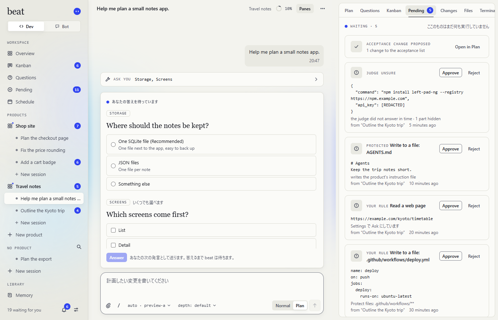
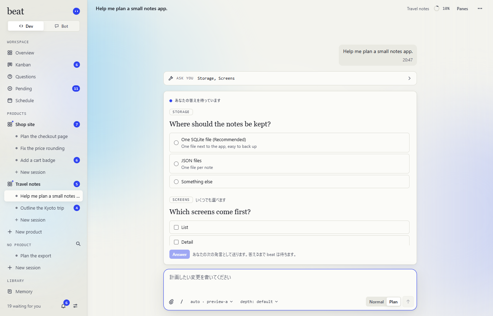
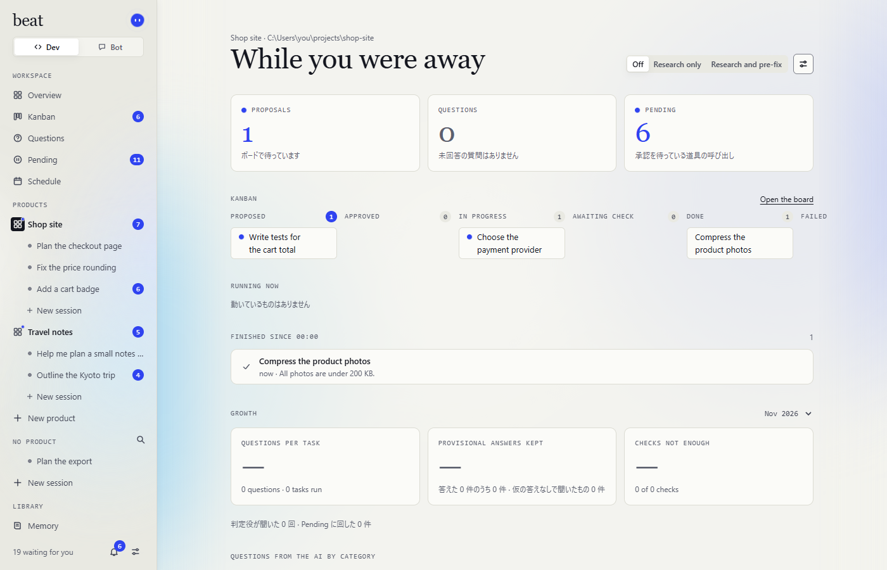
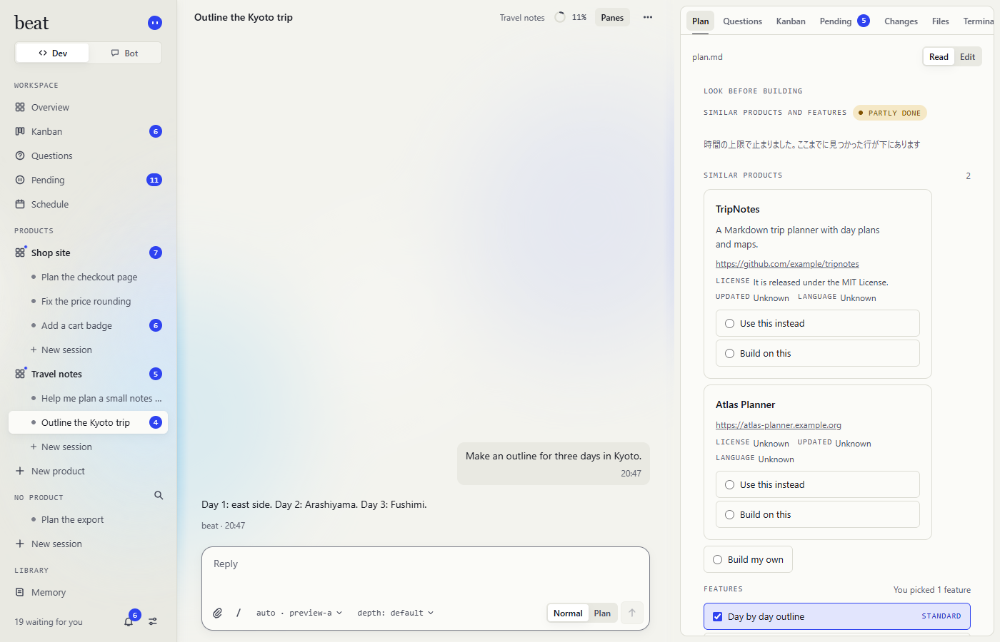
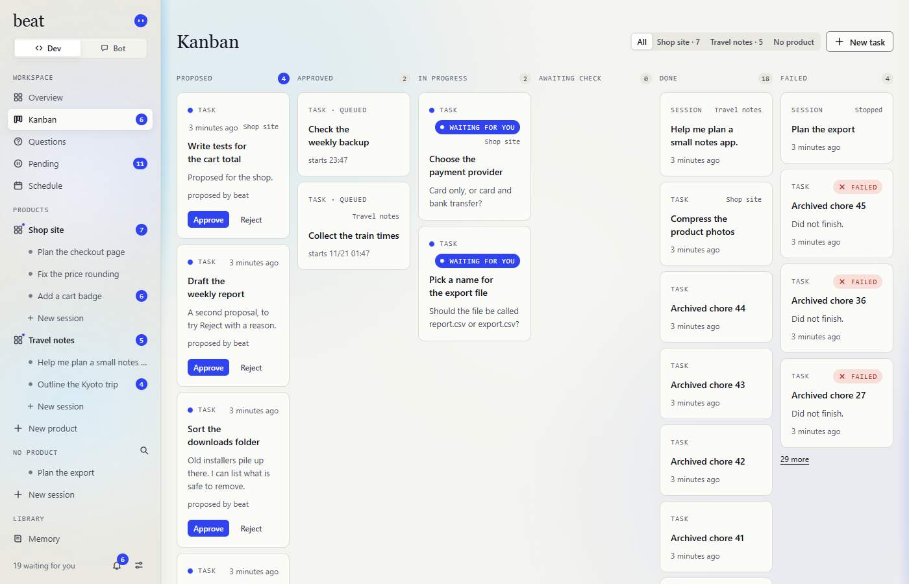
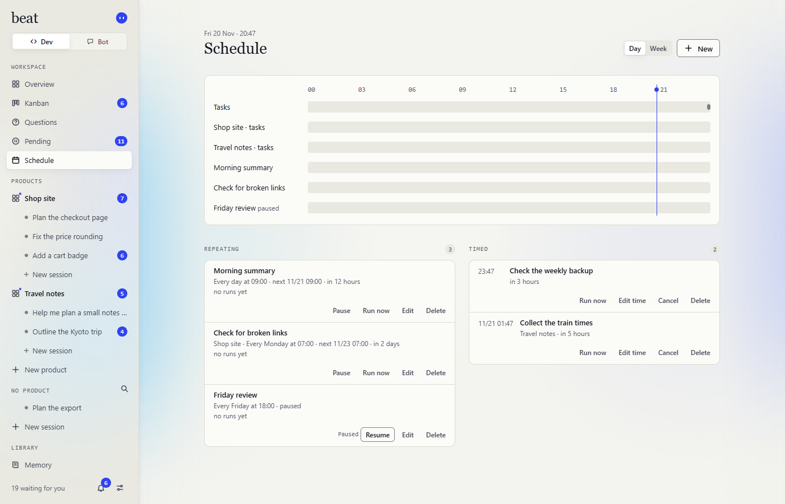
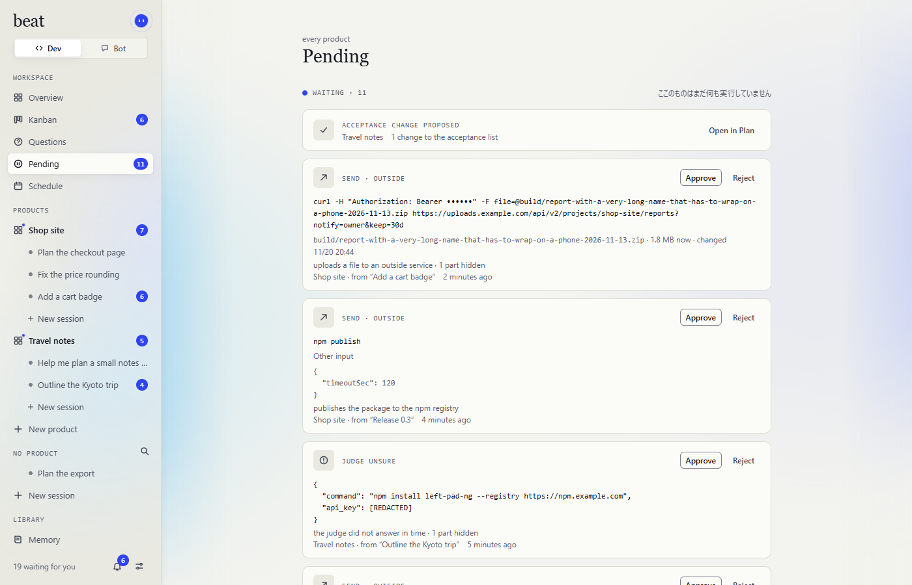
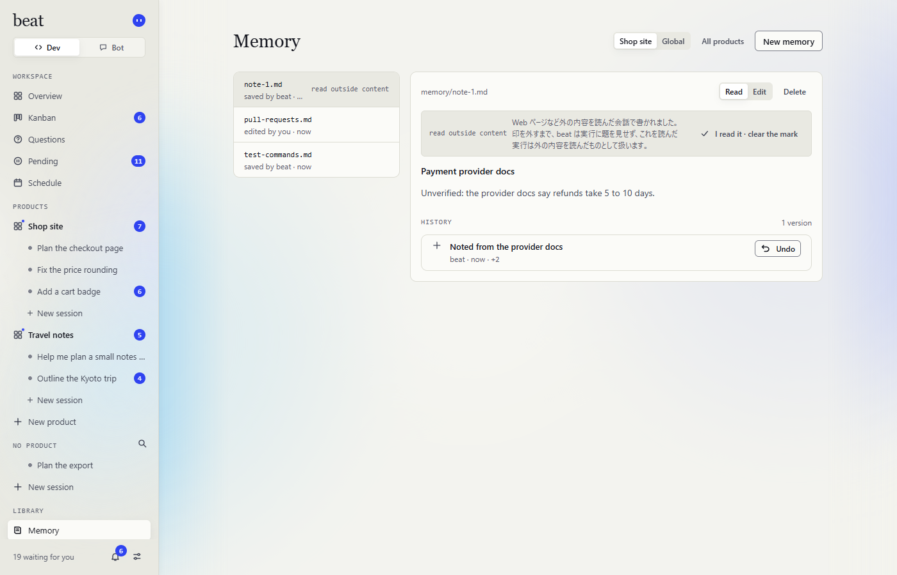
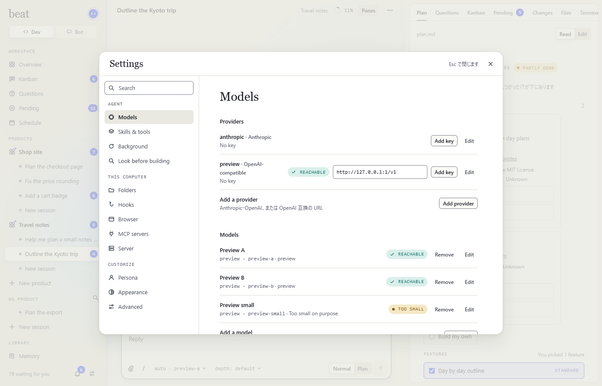

# beat

beat は、あなたの PC でずっと動いている、あなた専用の AI エージェントです。
ブラウザで開いて話しかけると、調べもの・計画・コードを書く作業などを、あなたが見ていないあいだも裏で進めます。
外へ送る・消すといった危ない操作は、勝手にやらずに、あなたの OK を待ちます。



## できること

### 会話する

ブラウザで beat に話しかけます。返事は書きながら表示され、途中で止めることもできます。
beat が決めかねたことは、選択肢つきの質問として出てくるので、選んで答えるだけで進みます。
ファイル（テキスト・PDF・画像など）を添えて送ったり、会話ごとに使うモデルを選んだりもできます。

入力欄の右下では、2 つのモードを切り替えられます。

- **Normal**: ふつうに作業する。危ない操作は、下の「承認待ちの一覧」に回る
- **Plan**: 何も変えない。調べて、計画を書くだけ



### 製品（プロジェクト）ごとに進める

作りたいもの・手を入れたいものを「製品」として登録します。製品は、PC の中のフォルダ 1 つです（コードでなくても、git を使っていなくてもかまいません）。
製品のホームには、あなたがいないあいだに起きたこと（beat からの提案・質問・承認待ち・終わった作業）がまとめて出ます。
フォルダに `AGENTS.md`（または `CLAUDE.md`）があれば、beat はそれを指示として読みます。



### 作る前に調べる

新しい製品について話し始めると、beat は先に Web で「似ている製品」と「よくある機能」を調べます（設定で、ボタンを押したときだけにも、オフにもできます）。
見つかったものを見て、「これを使う」「これを土台にする」「自分で作る」や、入れたい機能を選びます。計画に入るのは、あなたが選んだものだけです。
計画ができたら「Build with this plan」で作業を始めます。
Web の検索は、既定で複数の検索サイト（DuckDuckGo・Bing・Wikipedia）へ問いを送ります。どこへ送るかは設定の `tools.web.engines` で選べます。断られたサイトはしばらく休ませ、別のサイトに移ります。



### 裏で動くタスク

頼んだ作業は「タスク」になり、beat が裏で 1 件ずつ進めます。画面を閉じていても動きます。
Kanban の画面で、提案（Proposed）・実行中・終わったものなどを一目で見られます。beat が自分から提案したタスクは、あなたが Approve するまで動きません。
途中で分からないことがあれば、beat は質問を残して待ちます。



毎日・平日・毎週・毎時・N 分ごとの繰り返しや、日時を決めた 1 回だけの実行も頼めます。Schedule の画面で、予定の一覧と時間の並びを確かめられます。



### 承認待ちの一覧（Pending）

外へ送る操作や、元に戻せない削除などは、beat が実行せずにここへ積みます。
中身（コマンドや書き込む内容）を見て、**Approve** で実行、**Reject** で取りやめます。Approve が効くのはその 1 回だけです。
積まれたものは、あなたが決めるまで何も実行されていません。



### 記憶

beat は、製品について分かったこと（よく使うコマンド、決めた約束ごとなど）を覚えておき、次の作業で使います。
記憶は製品ごとに、製品の中の Markdown のファイルとして残ります。Memory の画面で読む・直す・消すができ、変えた履歴から元に戻せます。
Web ページなど外から来た内容を読んだあとに書かれた記憶には印が付き、あなたが確かめるまで慎重に扱われます。



### 設定とモデル

クラウドのモデル（Anthropic、OpenAI 互換の API）と、PC で動かすローカル LLM（LM Studio・llama.cpp・vLLM・TabbyAPI・Ollama など、OpenAI 互換のサーバー）を使えます。
モデルを何個か並べておくと、つながらないときに次のモデルへ切り替えます。モデルを足すと、その場で接続とコンテキスト長（一度に読める量）を確かめます。
設定は画面の左下のボタンから開きます。フォルダの範囲、ブラウザの道具、スマートフォンからの接続なども、ここで決めます。



> 画面のメニューやボタンは英語です。説明の文は、設定の Appearance › Explanation language で日本語にできます。beat はあなたが書いた言語で返事をします。

## 必要なもの

- **Node.js 24.16 以上**
- **使うモデルのどれか 1 つ**
  - Anthropic の API キー
  - OpenAI 互換の API（OpenRouter・OpenAI など）のキー
  - ローカル LLM（OpenAI 互換のサーバー）
- （ブラウザの道具を使うときだけ）**Google Chrome**。Microsoft Edge は使えません

Windows と Linux で動きます。

## はじめかた

1. このリポジトリを手元に置き、フォルダに入ります。
2. まとめて起動します。依存を入れ、画面をビルドして、beat を起動します。
   - Windows: `.\start.ps1`
   - Linux: `./start.sh`
3. ブラウザで <http://127.0.0.1:4777/> を開きます。
4. 「はじめの設定」が出ます。あなたの名前 → beat の名前 → 話し方 → モデル の順に答えます。
   最初はモデルが 1 つも入っていないので、ここで足してください（あとから設定の Models でも足せます）。API キーは画面に貼り付ければ保存されます。
5. 左の「New product」で、作業するフォルダを登録します。そのフォルダについて話しかければ始まります。

手で起動したいときは、次のとおりです。

```bash
npm install
npm run build:web
npm start
```

- API キーは画面から入れるのがいちばん簡単です。ファイルに書きたいときは [.env.example](.env.example) を写して `.env` を作ります。
- データ（設定・会話・タスクなど）は `data/` フォルダに入ります。場所を変えるときは `npm start -- --data-dir <フォルダ>` です。
- 止めるときは、起動したターミナルで Ctrl+C を押します。
- Linux でサービスとして常に動かすときは [deploy/beat.service](deploy/beat.service) を使います（使い方はファイルの先頭にあります）。

## スマートフォンから使う

beat は、この PC の中（127.0.0.1）からしか開けません。スマートフォンなど別の端末から使うときは、[Tailscale](https://tailscale.com/) を通します。

1. beat の PC で `tailscale serve --bg 4777` を実行します。
2. 表示された `https://<マシン名>.<tailnet名>.ts.net` を、設定の Server › Allowed addresses に足します。
3. 同じ画面の「Restart」を押します（beat 自身は止まらず、動いている作業もそのまま続きます）。
4. スマートフォンでそのアドレスを開きます。

使える人を絞るときは、Server › Allowed Tailscale logins に、その人の Tailscale のログイン名を足します（空なら、同じ tailnet の人なら誰でも入れます）。

## 安全のために beat がすること

beat は AI に作業を任せる道具なので、危ない操作の前で止まるようにできています。

- **必ずあなたに聞くもの**: 外へ送る操作（アップロード、`git push`、`npm publish` など）、元に戻せない削除、大事な設定ファイル（製品の `AGENTS.md`、`.github/workflows` など）への書き込み。これらは実行せずに Pending に積みます。
- **AI の判定役が見るもの**: そのほかのコマンドなどは、別の AI（判定役）が「あなたの頼みに沿っているか」を確かめてから動かします。判定役が通せないものも Pending に回ります。
- **触れてよい場所を決められる**: beat が読み書きできるフォルダは、設定の Folders で決めます。その外や、秘密のファイルには触れません。
- **何もしない Plan モード**: 調べて計画を書くだけにしたいときは、会話を Plan にします。
- **繰り返しの承認を減らせる**: 同じ操作を何度も承認するのが面倒なら、Pending の「Approve, and don't ask again in this product」で、その製品の中だけ次から聞かないようにできます。決めたものは設定の Skills & tools で外せます。

気をつけてほしいこと:

- 判定役の AI も間違えることがあります。外から来た文章（Web ページなど）にだまされる可能性もゼロではありません。大事なフォルダは、触れてよい場所に入れないでください。
- 製品のフォルダの中のプログラム（`npm test` など）は、判定役を通さずに動きます。プログラムの中身が外へ送ったり消したりする場合、それは止められません。
- 判定役の料金を払いたくないときは、設定の Models で判定役を Off にできますが、そのぶん AI が確かめなしに動きます。

## よくある質問

**送っても返事が来ず「No model configured」と出る**
モデルがまだ入っていません。はじめの設定か、設定の Models の「Add a model」でモデルを足してください。

**ローカル LLM で「コンテキストが足りない」と出る**
beat は毎回、指示・道具の説明・記憶・会話をまとめて送るので、ある程度の長さが要ります。目安は最低 32k、道具や記憶を使うなら 64k 以上です。必要な長さは、設定の Models › モデル › Advanced の「Least context needed」に出ます。長さはサーバーの側で上げてください（LM Studio はモデルを読み込むときの Context Length、llama.cpp は `-c`、vLLM は `--max-model-len`、Ollama は `OLLAMA_CONTEXT_LENGTH`）。

**Ollama はどうつなぐ？**
OpenAI 互換のサーバーとして、`http://127.0.0.1:11434/v1` を入れてください。

**ブラウザの道具が使えない**
ブラウザの道具は、最初は切ってあります。設定の Browser でオンにしてください。PC に Google Chrome が入っている必要があります。

**スマートフォンから開けない**
アドレスを Allowed addresses に足したあと、「Restart」を押したか確かめてください。beat のポートを変えたときは、`tailscale serve --bg <新しいポート>` もやり直します。

**裏の作業を止めたい**
Overview の「Pause」で、裏の作業をまとめて一時停止できます。タスク 1 件だけなら、Kanban からそのタスクを開いて「Cancel task」で取り消せます。

## 開発する人へ

| コマンド | 内容 |
|---|---|
| `npm start` | 起動（`.ts` をビルドせずそのまま動かす） |
| `npm run dev` | ファイルを変えると再起動する |
| `npm run build:web` | 画面をビルドする（`web/dist`） |
| `npm run dev:web` | 画面だけを開発する（Vite。API は `npm start` のサーバーへ転送） |
| `npm test` | テスト |
| `npm run typecheck` | 型チェック（サーバーと画面） |
| `npm run check` | 型チェック＋テスト＋画面のビルド |

サーバーは `src/`、画面は `web/src/`（React + Vite）、テストは `tests/` にあります。
`node scripts/preview-server.ts` で、作り物のデータだけを使う試しのサーバー（ポート 4797）を起動できます。この README の画像も、このサーバーで撮りました。
検索サイトごとに本当に使えるかは `node --import ./tests/helpers/tsx-loader.mjs scripts/search-smoke.ts` で確かめられます（各サイトへ 1 回ずつ問いを送ります）。

Web 検索の作り（複数の検索サイトを少しずつ同時に試す・断られたサイトを休ませる・結果を URL でまとめて並べる）は、[ddgs](https://github.com/deedy5/ddgs)（MIT）と [open-websearch](https://github.com/aas-ee/open-websearch)（Apache-2.0）の考え方を参考にしました。コードは写していません。
